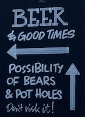

{ align=left }

I often find myself listening to or seeing something and letting my mind wander to where that could possibly lead. I have to admit that my thoughts are not always accurate predictions of the future, which is why this section aligns to [Reflecting](../Relflecting/index.md) in many ways, but I hope that some of the *thinking pieces* here may in turn prompt some ideas on your part

### Recent posts relfecting my thinking include:

-   :lucide-grip-horizontal:{ .lg .middle } __Small thing in combination can solve big problemms__

    ---

    Does creating small units and then combining, a bit like lego bricks, really hold outr future solkutions to problems?

    [:octicons-arrow-right-24: Small Things](smallthings.md)

-   :lucide-brain:{ .lg .middle } __IS AI really anything new?__

    ---

    We are currently dealing with the potential upheaval caused by AI. I try to separate the espoused hype from reality

    [:octicons-arrow-right-24: Reference](#)

-   :material-format-font:{ .lg .middle } __Made to measure__

    ---

    Change the colors, fonts, language, icons, logo and more with a few lines

    [:octicons-arrow-right-24: Customization](#)

-   :material-scale-balance:{ .lg .middle } __Open Source, MIT__

    ---

    Zensical is licensed under MIT and available on [GitHub]

    [:octicons-arrow-right-24: License](#)

